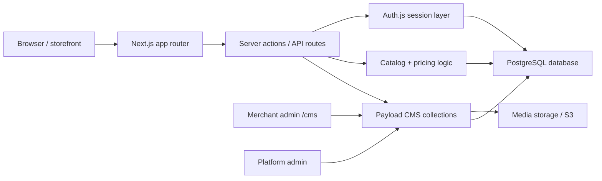

# Backend architecture audit

## Current architecture

The repo is a monolithic Next.js application with a CMS-backed admin layer, not a cleanly separated microservice SaaS. The application uses:

- `Next.js 16` App Router for storefront and server actions
- `Payload CMS 3` for admin, content, product catalog, orders, inventory, and platform data
- PostgreSQL through Payload's Postgres adapter
- `Auth.js` for storefront customer auth
- S3-compatible storage for private media

This means the system is already built as a hybrid architecture: the storefront and business logic live in the application, while the system-of-record database and admin tooling are packaged in Payload collections and globals.

## High-level architecture diagram

## Observed module layout

- `src/app` — route handlers, storefront pages, account flows, checkout actions
- `src/lib` — pricing, auth, email, cart, ordering, storage, notifications, rate limits, etc.
- `src/payload` — collection definitions, access control, globals, endpoints
- `src/migrations` — schema migration history
- `prisma/` — legacy database layer left in place; not the primary system

## Current state versus recommended target

### Current state

- Product and sales data live in Payload collections
- Store membership and tenant primitives are implemented at the model level
- Store-specific access is centralized in `src/payload/access.ts`
- SaaS billing primitives exist in `src/payload/collections/billing.ts`
- Server-side pricing prevents trusting the browser for final totals

### Recommended target

A production-ready target architecture would separate concerns more clearly:

1. Security boundary: tenant-aware service layer enforced on every read/write
2. Payment orchestration: provider SDK + webhook validation + idempotency + reconciliation
3. Inventory engine: reservation, release, and atomic stock adjustment with explicit concurrency controls
4. Subscription engine: plan entitlements and billing automation with provider synchronization
5. Audit and event journal: immutable audit log for admin, payment, and order changes
6. Observability: structured logs, metrics, and alerting around stock and payment failures

## Missing architectural controls

- no full platform-wide tenant enforcement registry for every collection
- no verified transactional outbox for payment/order event propagation
- no confirmed provider-specific webhook replay protection for all financial events
- no end-to-end entitlement enforcement layer for subscription limits across stores

## Assessment

The current architecture is workable as a strong commerce foundation and likely enough to continue product development, but it is not yet a fully hardened SaaS platform with explicit infrastructure boundaries and operational controls for multi-tenant commerce at production scale.
