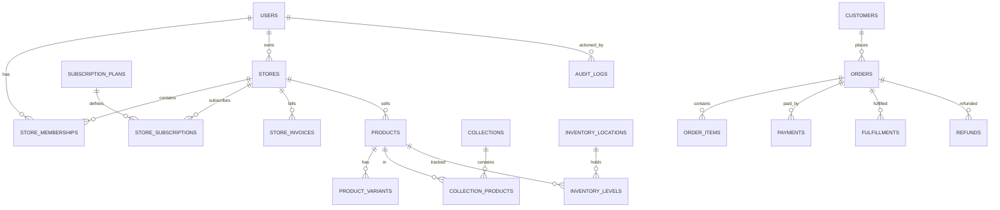

# Database audit

## Overview

The project uses PostgreSQL through Payload CMS, with a legacy Prisma layer retained for migration/demo support. The primary current schema evidence is in Payload collection definitions and migrations under `src/payload` and `src/migrations`.

## Primary discovered entities

Evidence from the codebase shows the following important domains:

- users
- stores
- store memberships
- subscription plans
- store subscriptions
- store invoices
- products / product collections / categories / brands
- media
- orders
- customers
- inventory records / stock movements
- return and warranty records
- discounts and flash sales
- payment-related settings and webhook-related domains (in various global/collection files)

## Schema evidence

Relevant files:

- `src/payload/collections/Users.ts`
- `src/payload/collections/Stores.ts`
- `src/payload/collections/StoreMemberships.ts`
- `src/payload/collections/billing.ts`
- `src/payload/collections/catalog.ts`
- `src/payload/collections/inventory.ts`
- `src/payload/collections/content.ts`
- `src/payload/collections/sales.ts`
- `src/migrations/`

## Tenant model and ownership

The tenant model is in its early but real form:

- `Users` supports `platformRole`, `currentStore`, and `stores`
- `Stores` include `owner`, `members`, status, plan, subscription status
- access-level filtering is centralized in `src/payload/access.ts`

This is evidence that the project is moving toward multitenancy, but the code does not yet prove every domain is fully tenant-isolated.

## Constraints and integrity observations

The codebase contains a reasonable set of field constraints and relationships, including:

- unique `slug` / `subdomain` checks in the onboarding logic
- required foreign relationships such as store and plan IDs
- select enums for statuses and plan lifecycle states
- `hasMany` relationships where appropriate

However, the code does not provide a complete proof that all of the following are implemented everywhere:

- tenant foreign keys on every commerce collection
- unique indexes for critical business keys
- safe delete policies for historical order data
- stock movement / reservation rollback guarantees
- audit trail for modification of financial records

## ER overview

## Risk summary

- The underlying model is promising and includes multi-tenant primitives
- Historical integrity requirements for orders and inventory are not fully proven from the collection definitions alone
- There is not enough evidence in this audit to certify that each tenant-specific table has complete foreign-key enforcement and deletion safety

## Assessment

Database architecture is in a promising beta-to-MVP state, but it is not yet a documented, fully hardened multi-tenant commerce schema with enterprise-grade constraints and audit trails.
