# 03 · Database audit

State audited: **commit `aab6879`**. Sources: Payload collection configs (`src/payload/collections/*`), 31 Payload migrations
(`src/migrations/*.ts`) and the latest schema snapshot `src/migrations/20261012_122952_product_variants.json`
(173 tables, 94 enums, 0 CHECK constraints). The 31 committed migrations were applied to an empty local PostgreSQL 18
during this audit and succeeded **after** the duplicate-field boot blocker was removed.

## 1. Engine, schemas and runtime layer

- PostgreSQL. Payload owns schema `payload` (all tables prefixed `cms_`, see `dbName()` in `src/payload/fields.ts:46`).
- Legacy Prisma tables (16 models) live in `public` and are frozen; Prisma is still imported by `src/auth.ts`, `src/lib/auth.ts`, `src/lib/repo/{db,orders,messages,wholesale}.ts`. Most branches are gated by `isCmsConfigured`, but banners/FAQs/wholesale still reach Prisma in CMS mode (`src/lib/repo/catalog.ts:404-454`, `src/lib/repo/wholesale.ts:106-108`).
- `push: false` + `prodMigrations` (`src/payload.config.ts:152,156`): **the database only changes through committed migrations**, and pending migrations also run at server start.
- Conventions in the snapshot: serial integer PKs; relationship FKs `ON DELETE SET NULL`; array/`_rels` child tables `ON DELETE CASCADE`; money and stock are `numeric` without precision; no CHECK constraints (negative prices/stock are only blocked by app validation).

## 2. Critical drift: config vs. migrations

No committed migration creates any of the following, although the config references them:

| Missing object | Referenced by |
|---|---|
| `cms_stores`, `cms_store_memberships`, `cms_subscription_plans`, `cms_store_subscriptions`, `cms_store_invoices` (+ their `_rels`) | `src/payload.config.ts:138` |
| `cms_users.platform_role`, `cms_users.current_store_id`, `cms_users_rels` (for `stores` hasMany) | `src/payload/collections/Users.ts:197-225` |
| `store_id` on `cms_products` (+ `_cms_products_v`), `cms_categories`, `cms_brands`, `cms_reviews`, `cms_suppliers`, `cms_purchases`, `cms_stock_counts` | `catalog.ts:297,342,407,573`; `inventory.ts:24,103,147` |
| new columns on `payload_locked_documents_rels` / `payload_preferences_rels` for the 5 new collections | Payload internals |

Impact: every query on `users` (i.e. login), `products`, `categories`, `brands`, `reviews` would select non-existent columns, and the 5 SaaS collections would fail with "relation does not exist". `payload-types.ts` is also stale (no `store` on `Product`, `src/payload-types.ts:542`), which is why the code is littered with `as never` casts.

## 3. Conceptual entity comparison

| Conceptual entity | Equivalent | Exists | Tenant-owned (`store_id`) | Notes |
|---|---|---|---|---|
| users | `cms_users` | ✅ | ✗ (global) | unique email; role NOT NULL; customers + staff + merchants in one table |
| sessions | `cms_users_sessions` + Auth.js JWT | ✅ | — | Payload sessions cascade; storefront JWT is stateless (30 days) |
| stores | `cms_stores` | ⚠ config only | — | no migration |
| store_memberships | `cms_store_memberships` | ⚠ config only | n/a | no unique `(store, user)`; no migration |
| roles / permissions | `users.role` enum + `platformRole` | ⚠ | ✗ | fixed roles; no permission table |
| products | `cms_products` (+ `_v` versions) | ✅ | ⚠ field, no column | unique `sku` (nullable) and `slug` **platform-wide** |
| product_variants | `cms_products` rows with `variant_of_id` (self-FK, SET NULL) + `option_values` jsonb | ✅ | ⚠ | no unique `(variant_of_id, option_values)` |
| product_options | `cms_products_variant_options` (CASCADE) | ✅ | via product | max 3 |
| product_media | `cms_products_images` / `cms_media` | ✅ | ✗ | media library is shared by all tenants |
| collections | `cms_collections` (+ rules, rels) | ✅ | ✗ | |
| collection_products | `cms_collections_rels` | ✅ | ✗ | |
| inventory_locations | — | ✗ | — | single implicit location |
| inventory_levels | `cms_products.stock` (numeric) | ⚠ | ✗ | per variant, not per location |
| inventory_movements | `cms_stock_movements` | ✅ | ✗ | no idempotency key; purged after 730 days |
| inventory_reservations | `cms_units.status` (serials) + `orders.stock_held` | ⚠ | ✗ | no checkout reservation table |
| customers | `cms_users` (role customer, `has_account`) | ⚠ | ✗ | no store-scoped customer profile |
| customer_addresses | `cms_users.addresses` jsonb (≤10) | ⚠ | ✗ | not relational |
| carts / cart_items | browser localStorage; `cms_abandoned_carts` (contact + jsonb) | ⚠ | ✗ | no server cart |
| checkouts | — | ✗ | — | stateless server action |
| orders | `cms_orders` | ✅ | ✗ | unique `order_number`, unique `attempt_id`; FK `user_id` SET NULL |
| order_items | `cms_orders_items` (CASCADE) | ✅ | via order | title/unit_price/qty NOT NULL snapshot; `product_id` SET NULL; no SKU snapshot |
| payments | fields on `cms_orders` (`payment_method`, `payment_status`, `advance_paid`, screenshot) | ⚠ | ✗ | no payment table; no index on `payment_status` |
| payment_events | — | ✗ | — | |
| refunds | `cms_return_requests` (refund amount/method, credit note) | ⚠ | ✗ | no refund ledger |
| fulfillments / fulfillment_items | order status + courier/tracking fields | ⚠ | ✗ | no fulfillment entity, no partials |
| shipping_zones / shipping_rates | `cms_shipping_zones` / `cms_shipping_zones_cities` (global) | ✅ | ✗ (global) | |
| discounts | `cms_discounts`, `cms_flash_sales` | ✅ | ✗ | unique `code` **platform-wide**; `used`/`usage_limit` unconstrained |
| themes | `cms_theme_settings` (+ header/footer/… globals, `_v` history) | ✅ | ✗ (global) | |
| pages | `cms_pages` (+ 18 `cms_pb_*` block tables, `_v`) | ✅ | ✗ | |
| domains | `cms_stores.subdomain` (unique) / `custom_domain` (text) | ⚠ config only | — | no verification state |
| subscription_plans | `cms_subscription_plans` | ⚠ config only | — | |
| subscriptions | `cms_store_subscriptions` | ⚠ config only | `store_id` | no unique active subscription per store |
| invoices | `cms_store_invoices` | ⚠ config only | `store_id` | unique `invoice_number` |
| audit_logs | `cms_activity_log` | ✅ | ✗ | API-immutable; purged after 730 days |
| webhook_events | — | ✗ | — | |
| outbox_events | — | ✗ | — | |

Legend: ✅ exists and migrated · ⚠ partial / config-only / modelled differently · ✗ absent.

## 4. Keys, constraints and indexes (core tables, from the snapshot)

| Table | Unique | Foreign keys (ON DELETE) | Notable indexes | Gaps |
|---|---|---|---|---|
| `cms_users` | email, legacy_id | — | email | no tenant link (pending migration) |
| `cms_products` | sku (nullable), slug, legacy_id | brand, category, variant_of (self), meta_image → SET NULL | brand, category, status, `_status`, stock_status, variant_of | uniques must become per store; no CHECK `stock >= 0` |
| `cms_orders` | order_number, attempt_id, legacy_id | user → SET NULL | status, placed_at, customer phone/email/city, confirmation_token, user | no `payment_status` index; `coupon_code` varchar with no FK |
| `cms_orders_items` | — | product → SET NULL; parent → CASCADE | parent | no SKU / option snapshot columns |
| `cms_discounts` | code, legacy_id | — | — | `used <= usage_limit` not enforced in DB (enforced by conditional UPDATE in `stock.ts:123-131`) |
| `cms_stock_movements` | — | product, by → SET NULL | product, reason, reference | no idempotency key |
| `cms_return_requests` | request_number | order → SET NULL | status, order_number, phone | items product → SET NULL |
| `cms_pos_sales` | receipt_number | cashier → SET NULL | — | no client idempotency key |
| `cms_units` | serial | product, order, sale → SET NULL | — | |
| `cms_abandoned_carts` | token | — | status, contact, email, phone, last_activity_at | |
| `cms_activity_log` | — | user → SET NULL | action, entity, doc_id | |

Deletion behaviour: deleting a product nulls `product_id` on order items, stock movements, units, reviews, return items and POS items. Orders keep title, unit price, qty, slug, url, image and upgrades, but lose SKU and option values. Deleting a variant parent turns its variants into standalone **active** products (`variant_of_id` SET NULL, `src/migrations/20261012_122952_product_variants.ts:31`).

## 5. Discovered relationships (actual schema)

```mermaid
erDiagram
  CMS_USERS |o--o{ CMS_ORDERS : "user_id SET NULL"
  CMS_USERS |o--o{ CMS_POS_SALES : "cashier_id SET NULL"
  CMS_USERS |o--o{ CMS_STOCK_MOVEMENTS : "by_id SET NULL"
  CMS_USERS |o--o{ CMS_ACTIVITY_LOG : "user_id SET NULL"
  CMS_CATEGORIES |o--o{ CMS_CATEGORIES : "parent_id SET NULL"
  CMS_CATEGORIES |o--o{ CMS_PRODUCTS : "category_id SET NULL"
  CMS_BRANDS |o--o{ CMS_PRODUCTS : "brand_id SET NULL"
  CMS_PRODUCTS |o--o{ CMS_PRODUCTS : "variant_of_id SET NULL"
  CMS_PRODUCTS ||--o{ CMS_PRODUCTS_VARIANT_OPTIONS : "CASCADE"
  CMS_PRODUCTS |o--o{ CMS_REVIEWS : "product_id SET NULL"
  CMS_PRODUCTS |o--o{ CMS_STOCK_MOVEMENTS : "product_id SET NULL"
  CMS_PRODUCTS |o--o{ CMS_UNITS : "product_id SET NULL"
  CMS_ORDERS ||--o{ CMS_ORDERS_ITEMS : "CASCADE"
  CMS_ORDERS ||--o{ CMS_ORDERS_HISTORY : "CASCADE"
  CMS_PRODUCTS |o--o{ CMS_ORDERS_ITEMS : "product_id SET NULL"
  CMS_ORDERS |o--o{ CMS_UNITS : "order_id SET NULL"
  CMS_ORDERS |o--o{ CMS_RETURN_REQUESTS : "order_id SET NULL"
  CMS_RETURN_REQUESTS ||--o{ CMS_RETURN_REQUESTS_ITEMS : "CASCADE"
  CMS_ORDERS |o--o{ CMS_WARRANTY_CLAIMS : "order_id SET NULL"
  CMS_POS_SALES ||--o{ CMS_POS_SALES_ITEMS : "CASCADE"
  CMS_POS_SALES |o--o{ CMS_UNITS : "sale_id SET NULL"
  CMS_SUPPLIERS |o--o{ CMS_PURCHASES : "supplier_id SET NULL"
  CMS_DISCOUNTS |o..o{ CMS_ORDERS : "coupon_code (no FK)"
  CMS_STORES |o..o{ CMS_STORE_MEMBERSHIPS : "config only - no migration"
  CMS_STORES |o..o{ CMS_STORE_SUBSCRIPTIONS : "config only - no migration"
  CMS_STORES |o..o{ CMS_PRODUCTS : "store field - no column"
  CMS_ORDERS { varchar order_number UK }
  CMS_ORDERS { varchar attempt_id UK }
  CMS_PRODUCTS { varchar sku UK }
  CMS_PRODUCTS { varchar slug UK }
  CMS_DISCOUNTS { varchar code UK }
```

Dotted lines are relationships declared in the config but **not present in the database**.

## 6. Missing constraints and cross-store reference risks

| # | Issue | Risk | Recommendation |
|---|---|---|---|
| D1 | No `store_id` on orders, order items, customers, discounts, flash sales, returns, warranty, POS, cash-ups, units, abandoned carts, pages, menus, posts, media, collections, stock movements, activity log | Cross-tenant reads/writes; cannot attribute data | Add indexed `store_id` FK to every tenant table; backfill existing rows to a default store |
| D2 | Platform-wide unique `slug`, `sku`, discount `code` | Tenant B cannot use a slug/SKU/code that tenant A already uses | Composite unique `(store_id, …)` |
| D3 | Relationship targets not checked for same store (order item → product, purchase line → product, unit → product, collection → products, review → product) | Store B can reference store A's product and mutate its stock | `filterOptions` on relationship fields (Payload enforces them during validation) + server checks in endpoints |
| D4 | No `CHECK` constraints on money/stock | Negative totals via admin edits (`content.ts:456-459`) | `min: 0` validation + DB CHECKs for `stock >= 0`, totals `>= 0` |
| D5 | No unique `(store_id, user_id)` on memberships | Duplicate memberships with conflicting roles | Compound unique index |
| D6 | No payment / payment-event / webhook-event / outbox tables | No ledger, no dedup, no durable side effects | New tables with unique provider ids |
| D7 | Stock movements have no idempotency key | Retries can double-apply adjustments | Unique `(reason, reference, product)` where applicable |
| D8 | Variant combos not unique | Duplicate SKUs for the same option set | Unique `(variant_of_id, option_values)` |
| D9 | `coupon_code` is free text on orders | Code renamed/deleted → usage release hits the wrong row | Store discount id alongside the code |
