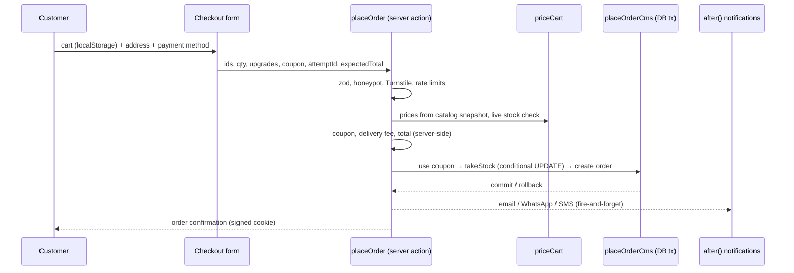

# 06 · End-to-end business flow audit

State audited: **commit `aab6879`**. Each flow was traced from the UI entry point to the database writes. Flows are judged as they would run
once the boot blocker (duplicate `store` field) is removed; for flows that need the SaaS tables, the missing migration alone makes them fail.

| Flow | Overall status |
|---|---|
| A · Merchant onboarding | **Broken** |
| B · Product lifecycle | Partial (works for the single shop) |
| C · Successful purchase | Partial (COD/manual payments only) |
| D · Failed payment | Missing (no online payment exists) |
| E · Refund | Partial (manual credit notes) |
| F · Multi-tenant isolation | **Broken** |
| G · Staff authorization | **Broken** |
| H · SaaS subscription | **Broken** |

**Broken business flows: 4 (A, F, G, H). Missing: 1 (D).**

---

## Flow A · Merchant onboarding — Broken

| Step | Frontend | Backend | Service | DB | Result |
|---|---|---|---|---|---|
| Register | `account/register/page.tsx` | `registerAction` (`account/actions.ts`) | `registerCustomer` (`lib/auth.ts:92`) | `cms_users` | ✅ |
| Verify email | `account/verify-email/page.tsx` | `confirmEmailCms` | HMAC token (`account-email.ts:54-73`) | `users.email_verified` | ✅ but **not required** before store creation |
| Create store | `account/stores/page.tsx` → `StoreOnboardingForm` | `createStoreAction` (`account/stores/actions.ts:27-49`) | `createStoreForUser` (`store-tenant.ts:133-275`) | `cms_stores`, `cms_store_memberships`, `cms_store_subscriptions`, `cms_users` | ❌ tables/columns not migrated; on success grants global `merchant_owner` (SEC-02) |
| Configure store | — | Stores `update` is platform-admin only (`Stores.ts:27`) | — | — | ❌ merchant cannot edit own store |
| Add product | `/cms` | Payload REST | `storeWriteAccess` | `cms_products.store_id` (missing column) | ❌ / product lands with `store=null` |
| Publish | `StorePublishedStatus` (`store-onboarding.tsx:152`) | `publishStoreAction` | `publishStore` (`store-tenant.ts:333-415`) | `cms_stores.status` | ❌ resets trial, un-suspends; store not routable (no host resolution) |

Events/jobs: none. Error handling: string errors returned to the form; slug race returns an unhandled unique-violation (`store-tenant.ts:150-161`).
Tests: none. Missing transitions: draft → active gated on setup completeness; suspended → active only by platform admin; trial → paid/expired.

## Flow B · Product lifecycle — Partial

| Step | Entry | Code | DB | Result |
|---|---|---|---|---|
| Create product | `/cms` Products | `catalog.ts:375-559` (drafts, autosave, schedule) | `cms_products` (+ `_v`) | ✅ |
| Add variants | "Create variants" button | `POST /cms-api/products/:id/create-variants` (`catalog.ts:43-98`) | variant rows with `variant_of_id` | ⚠ not transactional; variants active even if parent is draft; no store copied |
| Upload images | Media | `Media.ts` + S3 | `cms_media` | ✅ |
| Inventory | product `stock` field / purchases / stock count | `catalog.ts:122-148`, `inventory.ts:44-88`, `endpoints/inventory.ts` | `cms_products.stock`, `cms_stock_movements` | ⚠ admin save lost-update race; stock-count double subtract |
| Publish | `_status` publish | Payload versions | `cms_products._status` | ✅ |
| Edit | `/cms` | price manager-only, cost owner-only (`catalog.ts:430-432`) | | ✅ |
| Archive | `status=archived` | `catalog.ts:539-546` | | ✅ (variants of an archived parent stay sellable ❌) |

Tests: none for products. Buying a variant with an upgrade fails at checkout (`buy-box.tsx:42` vs `cart-pricing.ts:57-61`).

## Flow C · Successful purchase — Partial

| Step | Evidence | Status |
|---|---|---|
| View product → add to cart | `buy-box.tsx`, `src/store/cart.ts` | ✅ (variant+upgrade bug) |
| Checkout & server totals | `checkout/actions.ts:109-183`; `cart-pricing.ts:27-83` | ✅ client cannot set prices |
| Pay | COD or manual transfer with screenshot (`actions.ts:219-256`) | ⚠ no gateway; card refused |
| Verify webhook | — | ❌ none exists |
| Create/finalise order | `lib/cms/sales.ts:123-166` (single transaction) | ✅ idempotent only with `attemptId` |
| Update inventory | `stock.ts:86-89` atomic | ✅ |
| Merchant notification | `lib/notify.ts`, staff emails from global | ⚠ non-durable; platform-wide recipients |
| Fulfilment | order status → dispatched, courier + tracking (`content.ts:481-482`) | ⚠ no fulfilment entity/partials |

Tests: pricing helpers only (`tests/unit/money.test.ts`). Missing: order attributed to a store; online payment; payment ledger.

## Flow D · Failed payment — Missing

There is no online payment attempt, so there is no failure event. Manual-transfer orders sit in `awaiting-verification`
(`content.ts:463-476`); online-method orders cannot advance unless paid (`content.ts:114-116`); unconfirmed COD orders auto-cancel and release
stock after the confirmation window (`confirm.ts:95-125`). Missing: provider failure webhook, retry/recovery link, reservation expiry for
pending online payments.

## Flow E · Refund — Partial

| Step | Evidence | Status |
|---|---|---|
| Refund request | storefront returns form (`returns/actions.ts`) → `cms_return_requests` | ✅ (POS receipts rejected by regex `:21`) |
| Provider refund | — | ❌ |
| Financial records | refund amount/method + credit note number (`aftersales.ts:155-265,384-395`) | ⚠ no ledger; order `paymentStatus` never updated; cap can be exceeded (SEC-16) |
| Audit | activity log on return-requests | ✅ |
| Restock | capped by ordered minus already restocked (`aftersales.ts:194-238`) | ✅ (POS-return restock uncapped `:226`) |

## Flow F · Multi-tenant isolation — Broken

| Attempt by a user of store A | Result | Evidence |
|---|---|---|
| Read store B's products (incl. drafts, cost) | **Allowed** (after self-enabled 2FA) | `activeOrStaff` → `isStaffUser` (`access.ts:90-95`) |
| Read store B's orders and customers | **Allowed** | `content.ts:403`; `Users.ts:64` |
| Change store B's settings / payment accounts | **Allowed** — settings are shared globals | `globals/commerce.ts:73` |
| Update store B's product directly | Blocked by `{store in [A]}` filter… | `access.ts:77` |
| …but create into B, or move own product to B | **Allowed** | create ignores Where; `store` field unprotected |
| Change B's stock via purchases / stock count / variants endpoint | **Allowed** | `inventory.ts:44-88`; `endpoints/inventory.ts:164-194`; `catalog.ts:47` |
| Add themselves to B | **Allowed** via `PATCH users {stores:[B]}` | SEC-01 |

Tests: none for isolation.

## Flow G · Staff authorization — Broken

| Step | Evidence | Status |
|---|---|---|
| Owner invites staff | memberships creatable only by platform admins (`StoreMemberships.ts:27`); no UI/email | ❌ |
| Staff accepts | `acceptStoreInvitation` (`store-tenant.ts:277-331`) | ❌ no status check; overwrites global `platformRole` |
| Role assigned | membership `role` never evaluated | ❌ |
| Permitted actions succeed | via global `merchant_staff` ⇒ `isStaffUser` | ⚠ succeed — on every tenant |
| Restricted actions fail | revoke/suspend membership has no effect (`access.ts:34-38`) | ❌ |
| Admin sign-in | `/2fa/login` rejects `role==="customer"` (`two-factor.ts:341`) | ❌ merchants can't use the normal /cms login |

## Flow H · SaaS subscription — Broken

| Step | Evidence | Status |
|---|---|---|
| Select plan | onboarding form; any plan id accepted incl. archived (`store-tenant.ts:163-183`) | ❌ |
| Billing created | `store-subscriptions` row with `paymentProvider:"manual"` | ⚠ |
| Payment confirmed | — | ❌ no provider |
| Entitlements activated | limits never read | ❌ |
| Renewal / failure / cancellation | — | ❌ no jobs, no webhooks; trial reset on each publish |
