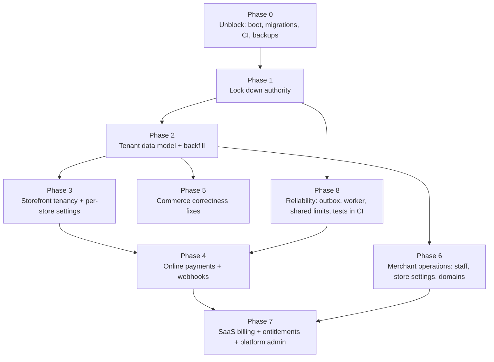

# 08 · Implementation roadmap

Built from the findings of this audit (state: commit `aab6879`). The order protects what already works — the single-store storefront,
server-side pricing, the transactional order path and atomic stock — and adds the tenant dimension underneath it before adding features on top.

## Phase 0 · Unblock (hours)

| Task | Files | Done when |
|---|---|---|
| Remove the duplicate `store` field on Suppliers | `src/payload/collections/inventory.ts:24-25` | `npx payload migrate` builds the config |
| Fix CI trigger branch (`main`) and `LOCAL_PRODUCTION_TEST` value | `.github/workflows/ci.yml:7,36` | CI runs on push to `main` |
| Fix backup image `sed` | `scripts/backup/Dockerfile:11-12` | `docker build -f scripts/backup/Dockerfile .` succeeds |
| Remove unused imports failing `--max-warnings=0` | `src/payload/collections/inventory.ts:2` | `npm run lint` exits 0 |
| Add a schema-drift check to CI (`payload migrate:create --dry-run`/snapshot diff) | `scripts/ci/` | CI fails when config and migrations diverge |

## Phase 1 · Lock down authority (P0, before any merchant can sign up)

1. Field access: `platformRole`, `stores` → platform admin only; `currentStore` → self, validated against active memberships; Stores `internalNotes` → platform admin only.
2. Rewrite `src/payload/access.ts`: platform authority (`owner` legacy role / `platform_admin`) vs. store authority (active `store-memberships`, role per store, cached per request). `merchant_*` platform roles no longer imply anything.
3. Legacy `manager`/`staff` map onto the default store only.
4. Refuse Payload REST/admin login for accounts that have no admin authority (customers keep the storefront login).
5. `deletableUsers`/`editableUsers` rank-aware for merchants; nobody but platform admins touches staff of other stores.
6. Privacy, config-transfer, print/proof/file routes: platform admin or same-store check + activity log.
7. Store onboarding: require verified email, cap stores per user, rate limit, reserved names, active plans only, trial once.

## Phase 2 · Tenant data model (P0)

1. One additive migration: SaaS tables, users columns, `store_id` on every tenant table, `isDefault` store, backfill all existing rows to the default store.
2. `assignStore` `beforeChange` hook for every tenant collection: store comes from the request context (storefront) or the admin's active store, validated against memberships, immutable afterwards.
3. Tenant-aware access builders (`read`/`create`/`update`/`delete` by store role) on every tenant collection.
4. Per-store uniqueness: `(store_id, slug)`, `(store_id, sku)`, discount `(store_id, code)`.
5. Same-store relationship validation (`filterOptions`) for order items, purchase lines, units, reviews, collections.

## Phase 3 · Storefront tenancy (P0/P1)

1. Host → store resolver (platform subdomain, verified custom domain, default store) used by every loader, server action and route handler.
2. Per-store cache keys/tags (catalog snapshot, pages, menus, settings, redirects).
3. Per-store settings: the 19 globals become store-scoped settings documents; the existing globals seed the default store.
4. Store status gate: draft → "coming soon" (members can preview), suspended/closed → unavailable page.
5. Store name/currency/locale from settings instead of hardcoded "Urko"/PKR; order-number prefix per store.

## Phase 4 · Online payments (P0)

1. Provider adapter interface + first adapter (Stripe Checkout/Connect, or Safepay/PayFast for Pakistan) — hosted collection only.
2. `payments` and `payment-events` collections; unique provider event id (dedup/replay); signed webhook route with timestamp tolerance.
3. Order `paymentStatus` driven only by verified events; idempotency keys on provider calls; refunds through the provider with a cap.
4. Per-store payment configuration (connected account id), never shared.
5. Reconciliation job (provider list vs. ledger) and COD remittance reconciliation.

## Phase 5 · Commerce correctness (P0/P1)

Variant + upgrade checkout bug · variants of inactive parents hidden · refund cap · `couponConsumed` flag · always lock order row on status change ·
POS idempotency key and `update: nobody` · admin stock save via atomic delta / row lock · lock order lines in id order (deadlocks) · stock-count
expected-at-first-scan · purchase receive lock · product delete guard + SKU/option snapshots on order lines · separate `fulfillmentStatus` ·
free-delivery threshold after discount · POS receipt regex · negative money validation · tax (rate per store, inclusive/exclusive).

## Phase 6 · Merchant operations (P1)

Staff invites by email with token, accept/revoke/change role, per-store permission presets · merchant-editable store profile (branding, contact,
currency, timezone) · store switcher in `/cms` · custom domains with DNS TXT verification · `/2fa/login` for merchant accounts.

## Phase 7 · SaaS billing & platform admin (P1)

Plan checkout via provider subscriptions, billing webhooks, invoices · entitlement enforcement in hooks (products, staff, storage) · trial expiry,
grace period and access restriction jobs · platform overview (stores, MRR, failed payments) · suspend/reactivate with audit · support access
with audit trail.

## Phase 8 · Reliability (P1, can run in parallel from Phase 1)

Transactional outbox for notifications/webhooks with retries, backoff and dead-letter · single worker role for jobs (`autoRun` off on web
instances) · shared rate limiter (Postgres table or Redis) · tenant-isolation, permission, checkout, webhook, refund and concurrency tests in CI ·
Sentry tracing and source maps · automated restore test.
